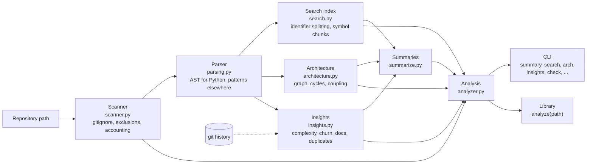
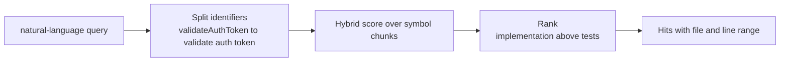

# Architecture and use cases

## System overview

One analysis pass scans a repository, parses symbols, and builds a search
index, a dependency graph and risk insights. Every command is a view over that
single result, and summaries state only what was measured.

## How a search works

## Components

| Module | Responsibility |
|---|---|
| `scanner.py` | Walks the repo, honours `.gitignore`, and reports what it kept and skipped |
| `parsing.py` | Python symbols from the AST. Other languages use labelled structural patterns |
| `search.py` | Identifier splitting, symbol-aware chunks, hybrid search, definition lookup |
| `architecture.py` | Dependency graph, import cycles, layer violations, fan-in and fan-out, Mermaid export |
| `insights.py` | Cyclomatic complexity, git churn, risk, documentation gaps, duplication |
| `summarize.py` | Extractive summaries from measured facts, with optional local-model prose |
| `analyzer.py` | The assembled pipeline: `Analysis` with `search`, `summary`, `duplicates`, `render_architecture`, `render_insights` |
| `cli.py` | `summary`, `search`, `arch`, `insights`, `check`, `files`, `duplicates`, `symbol` |

## Use cases

| Use case | Who | How it helps |
|---|---|---|
| Understand an unfamiliar codebase quickly | New team member | `summary` gives layout, entry points, key modules and languages, from measurements |
| Find where something is done | Any developer | `search "where do we validate the auth token"` returns symbols with file and line |
| Find hotspots to refactor | Tech lead | Risk is complexity weighted by churn, and it says so when churn is unknown |
| Spot undocumented complex APIs | Maintainer | Lists public symbols without docs, most complex first |
| Detect import cycles and coupling | Architect | The graph reports cycles, layer violations and the most depended-upon modules |
| Gate a pull request on architecture | CI owner | `repointel check . --max-cycles 0 --max-complexity 25` fails the build |
| Generate an architecture diagram | Documentation owner | `arch . --mermaid` outputs a diagram you can paste into a README |
| Find copy-pasted code | Reviewer | Duplicate detection across files |
| Prepare a due-diligence or onboarding review | Engineering manager | One command gives size, structure, risk and test-gap lists |
